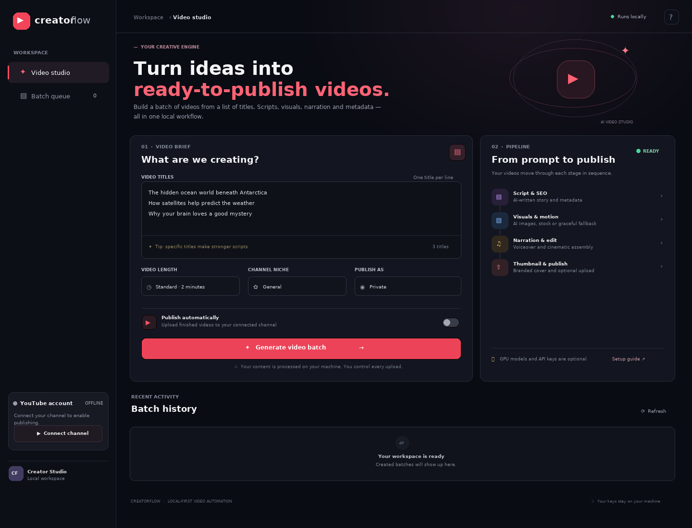

# YouTube Auto Creator

A local-first YouTube video automation studio. Enter a list of titles and it builds narrated videos, thumbnails and SEO metadata; with Google OAuth configured, it can also upload them to your channel. The web interface runs at `http://localhost:5000`.



**Default mode is safe and lightweight:** Ollama (if running) is used for scripts and metadata; image generation falls back to locally-created gradients when no Pexels key is configured; optional GPU image/video generation is off until you enable it. YouTube uploads are opt-in per batch. The studio header reports whether the configured Ollama model is loaded, installed but idle, missing, or unreachable; Ollama normally loads models on demand when a generation request arrives.

## Requirements

- Windows 10/11 (instructions below), Linux or macOS
- Python 3.10–3.12 (Python 3.11 recommended)
- FFmpeg available on `PATH` (MoviePy uses it to encode MP4)
- Optional: Ollama for locally generated scripts and SEO; Pexels API key for stock visuals; NVIDIA GPU/CUDA for local diffusion; Google Cloud OAuth credentials to upload

## Windows setup — step by step

### 1. Install Python and FFmpeg

Install Python 3.11 from [python.org](https://www.python.org/downloads/) and select **Add Python to PATH**. Install FFmpeg (for example, `winget install Gyan.FFmpeg`), open a new PowerShell window, and confirm:

```powershell
python --version
ffmpeg -version
```

If `ffmpeg` is not recognized, add the folder containing `ffmpeg.exe` to your Windows PATH and reopen PowerShell.

### 2. Create a virtual environment and install the application

From the repository root:

```powershell
cd backend
py -3.11 -m venv .venv
.\.venv\Scripts\Activate.ps1
python -m pip install --upgrade pip
pip install -r requirements.txt
```

If PowerShell blocks activation, run `Set-ExecutionPolicy -Scope CurrentUser RemoteSigned` once, then activate again. The requirements install a default PyTorch wheel. If you plan to use NVIDIA acceleration, follow **GPU generation** below after installing the requirements to replace it with the CUDA-enabled wheel that matches your system.

### 3. Configure local services and environment

```powershell
Copy-Item .env.example .env
```

Edit `backend/.env` with Notepad or your preferred editor. The starter values work without credentials. Recommended first-run settings:

```env
USE_OLLAMA=true
USE_LOCAL_IMAGES=false
USE_LOCAL_VIDEO=false
PEXELS_API_KEY=
```

Optionally install [Ollama](https://ollama.com/download), then run `ollama pull qwen2.5:7b`. Ollama must be running (`ollama serve`, if it does not start automatically). If Ollama is unavailable, the app uses a template script and basic SEO metadata. Add a free Pexels API key at `PEXELS_API_KEY` to enable stock-photo/video retrieval; without it, the app creates gradient visuals locally.

### 4. Optional YouTube upload setup

1. In [Google Cloud Console](https://console.cloud.google.com/), create/select a project, enable **YouTube Data API v3**, and configure the OAuth consent screen.
2. Create an OAuth client ID with application type **Desktop app** and download its JSON file.
3. Save it as `backend/client_secret.json`. Do not commit or share this private credentials file.
4. Start the app and click **Connect channel** in the sidebar. Sign in in the browser and grant the requested YouTube permissions. A reusable `backend/token.json` is created locally.
5. In the UI, turn on **Publish automatically** only when you are ready. New uploads default to **Private**. YouTube API quotas and account/channel eligibility still apply.

The app can be used without Google credentials; the connect button will explain what is missing. Public uploads are irreversible from this app, so keep the privacy selection on Private until you have reviewed the generated content.

### 5. Start the app

With the virtual environment active, from `backend`:

```powershell
python app.py
```

Open **http://localhost:5000**. Paste one video title per line, choose length and niche, and select **Generate video batch**. Videos are processed sequentially. Generated files are written to the ignored `output/` directory at the repository root; completed videos can be downloaded from the progress list.

To stop the server, press `Ctrl+C` in its terminal. Keep the terminal open while you use the app.

## NVIDIA GPU generation (optional)

Local SDXL Turbo and Stable Video Diffusion can use many gigabytes of VRAM and download several gigabytes of model weights on first use. They are intentionally disabled by default. The pipeline loads GPU models one at a time and releases VRAM between calls, but model memory varies with drivers and other running applications.

1. Install/update your NVIDIA driver and verify `nvidia-smi` works. CUDA toolkit installation alone does not make a CPU-only PyTorch wheel GPU-enabled.
2. In the virtual environment, install the PyTorch build appropriate for your platform from [PyTorch's install selector](https://pytorch.org/get-started/locally/). For example, current Windows CUDA wheels commonly use:
   ```powershell
   pip install torch torchvision --index-url https://download.pytorch.org/whl/cu121
   ```
3. Confirm `python -c "import torch; print(torch.cuda.is_available(), torch.cuda.get_device_name(0) if torch.cuda.is_available() else 'CPU')"` reports the GPU.
4. Set `USE_LOCAL_IMAGES=true` and/or `USE_LOCAL_VIDEO=true` in `.env`, then restart the server. Local video animation is the most VRAM-intensive option; on an 8 GB laptop GPU, close other GPU applications and allow the first model download to finish. If a local model cannot load or run, the pipeline continues with stock or gradient/still-image fallbacks.

## Configuration reference

| Variable | Purpose | Default |
|---|---|---|
| `USE_OLLAMA` | Use Ollama for scripts and SEO | `true` |
| `OLLAMA_MODEL` / `OLLAMA_URL` | Ollama model and API endpoint | `qwen2.5:7b` / `http://localhost:11434` |
| `USE_LOCAL_IMAGES` / `USE_LOCAL_VIDEO` | Optional CUDA image/video generation | `false` / `false` |
| `PEXELS_API_KEY` | Pexels stock visual fallback | empty |
| `YOUTUBE_PRIVACY_STATUS` | Default upload privacy | `private` |
| `MAX_UPLOADS_PER_DAY` | Local upload safety limit | `5` |
| `BATCH_DELAY_SECONDS` | Wait between titles | `10` |
| `OUTPUT_DIR` | Generated file directory | `../output` |

## Troubleshooting

- **`ffmpeg` not found / export fails:** install FFmpeg, add it to PATH and restart the terminal/server.
- **Ollama fallback appears:** check that Ollama is running and `ollama list` shows the configured model.
- **No stock images:** add a valid Pexels key; gradients are expected without one.
- **No GPU detected:** check the NVIDIA driver and install a CUDA-enabled PyTorch wheel into the active virtual environment. Local AI is optional.
- **YouTube OAuth issue:** confirm the Data API is enabled and the Desktop OAuth client JSON is saved under `backend/client_secret.json`. Test users may need to be added to the OAuth consent screen.
- **TTS fallback/silent narration:** confirm internet access for Edge TTS and install FFmpeg; narration generation requires network access to Microsoft's service.
- **Upload quota:** the YouTube Data API daily quota can be exhausted independently of this app's per-day upload counter.

## Project layout

```text
backend/       Flask API and generation pipeline
frontend/      Single-page dark-mode studio UI
output/        Generated media (ignored by Git)
```

Never put API keys, Google OAuth files, refresh tokens, or generated media in a public Git repository. `backend/.env`, `client_secret.json`, `token.json`, and output artifacts are excluded from Git.
